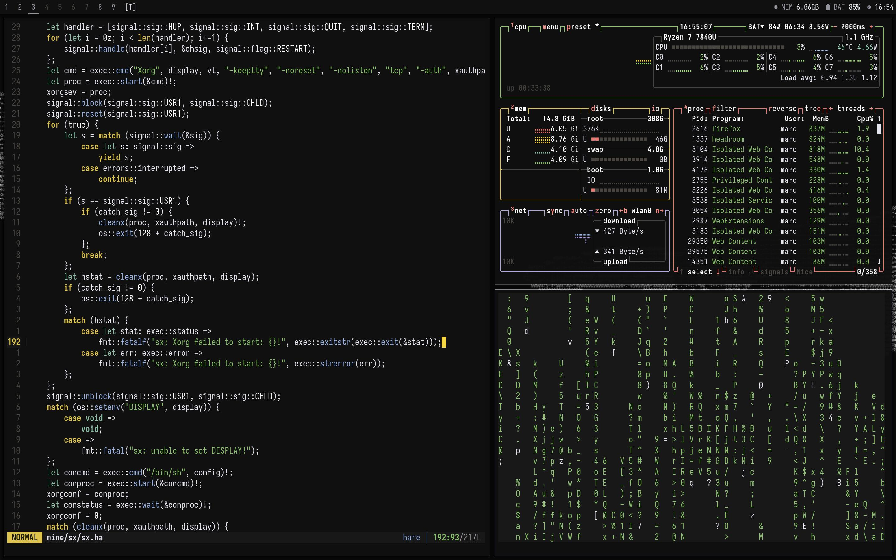

# Screenshot

# Keybindings

| Keybinding | Action |
|---|---|
| `Mod + Return` | Open terminal (`alacritty`) |
| `Mod + d` | App launcher (`rofi`) |
| `Mod + p` | Run menu (`dmenu`) |
| `Mod + q` | Close focused window |
| `Mod + j` / `k` | Focus stack down / up |
| `Mod + h` / `l` | Decrease / increase master width (`mfact`) |
| `Mod + Shift + h` / `l` | Increase / decrease client vertical factor (`cfact`) |
| `Mod + Space` | Toggle between layouts |
| `Mod + Shift + Space` | Toggle floating for window |
| `Mod + Shift + f` | Toggle actual fullscreen |
| `Mod + Ctrl + f` | Toggle fake fullscreen (borderless cover with floating on top) |
| `Mod + b` | Toggle status bar visibility |
| `Mod + Ctrl + =` / `-` | Increase / decrease vanity gaps |
| `Mod + Ctrl + g` | Toggle vanity gaps on / off |
| `Mod + Shift + r` | Restart dwm in-place |
| `Mod + Shift + q` | Quit dwm session |

# Note

* Some features are implemented with AI hence the name.

* Improvements needed.
